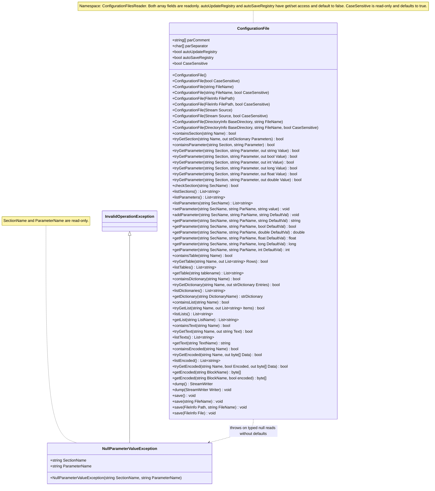

# IniLike

IniLike is a standalone C# library for reading INI-like configuration files organized into typed blocks.
It targets .NET Framework 3.5. 
The namespace and assembly name are **ConfigurationFilesReader**, and the public class is `ConfigurationFilesReader.ConfigurationFile`.

The implementation uses one partial class across ten source files in
`ConfigurationFilesReader/`: `ConfigurationFile.cs` holds shared settings and
constructors; `ConfigurationFile.Parsing.cs` handles block identification and loading;
`ConfigurationFile.Persistence.cs` handles dump/save and round-trip validation.
`ConfigurationFile.Sections.cs`, `ConfigurationFile.Tables.cs`,
`ConfigurationFile.Dictionaries.cs`, `ConfigurationFile.Lists.cs`,
`ConfigurationFile.Texts.cs` and `ConfigurationFile.Encoded.cs` hold the
respective storage and access methods, including parameter methods in Sections.
`ConfigurationFile.ReadOnly.cs` supplies collection views and snapshot creation;
`ConfigurationSnapshot.cs` and `ReadOnlyStringDictionary.cs` define the immutable
read API and the .NET 3.5 dictionary wrapper.

The parser represents block kinds with the private `BlockTypes` enum and maps
those kinds to their identifiers and aliases in the private readonly
`blockIdentifiers` dictionary. The include kind is `BlockTypes.Include`, following
the same capitalization as `Section`, `Table`, `List`, `Dictionary`, `Text` and
`Encoded`. File identifiers remain uppercase (`INCLUDE`, `INC`, `INPUT`, `LINK`,
`LOAD`); `BlockTypes.None` represents the state outside a block and is associated
with the `END` marker.

Documentation: [validator usage](ConfigurationValidator/README.md).

## File format

A **block** is the general unit introduced by a bracketed header. A **section** is
specifically a key/value block (`[NAME]`, `[SEC:NAME]` or `[SECTION:NAME]`). Tables,
lists, dictionaries, text, encoded data and includes are other block types.

```ini
## Full-line comment
[SERVER]
host = localhost
port = 8080
enabled = TRUE

[DIRECTORIES]
data = ./data/

[TABLE:ITEMS]
first; 10; active
second; 20; inactive
```

- `[NAME]`, `[SEC:NAME]` and `[SECTION:NAME]` are equivalent headers for section blocks
  containing `key = value` pairs.
- `[TABLE:NAME]`, `[TBL:NAME]` and `[TAB:NAME]` are equivalent table headers containing text rows.
  The library returns a `List<string>`;
  callers are responsible for splitting rows into columns using their specified
  column separator. Separators such as `;` are preserved, including at row edges.
  Blank or whitespace-only rows and rows starting with a `parComment` prefix
  after trimming are intentionally ignored, so they do not occupy table rows.
  A bracketed row is interpreted as a block header and ends the current table;
  literal bracketed rows cannot currently be escaped. Support for those rows is
  deferred to a future release.
- `[LIST:NAME]` and `[LST:NAME]` are equivalent list headers. Every data line is
  one string item: `mach1;` remains `mach1;`, and `x1=mach1.volt1` remains the
  complete string `x1=mach1.volt1`. Items are not parsed as key/value pairs;
  order, punctuation and duplicates are preserved. Lists use the same whitespace
  trimming and comment rules as tables.
- `[DICT:NAME]` and `[DICTIONARY:NAME]` are equivalent dictionary headers.
  Entries are string keys and string values: `x = 3` stores `"3"`, and
  `y = 3.14` stores `"3.14"`. They use the same key/value parsing, trimming and
  comment rules as sections, splitting entries at the first `=` and ignoring lines without `=`.
  Duplicate keys throw; case-only differences are distinct only with `CaseSensitive=true`.
- `[TEXT:NAME]` and `[TXT:NAME]` are equivalent plain-text block headers.
  Content supports Unicode and preserves whitespace, blank lines, `##` comment-looking
  lines, `=` and trailing punctuation. Any bracketed header starts a new block,
  just as in lists; `[END]` or `[END:NAME]` closes the text block. Header recognition
  uses trimmed lines, so bracketed lines cannot be stored as literal text.
  Text blocks have their own name space, using the selected case mode. `getText(name)` returns
  their lines joined with `\n` (without an added final newline); original CR/LF
  line-ending style is not retained. Empty and missing blocks return `""`;
  `listTexts()` distinguishes an existing empty block from a missing one.
- `[ENCODED:NAME]` and `[ENC:NAME]` contain one Base64-encoded binary payload.
  `[BASE64:NAME]` and `[B64:NAME]` remain accepted aliases for the same block type.
  Data may span multiple lines, even within a four-character group. Blank lines
  and comments are ignored; spaces, tabs and line breaks within the
  encoded data are accepted. Padding `=` is retained and punctuation is not
  stripped. Standard Base64 decoding uses `Convert.FromBase64String`; malformed
  input (including URL-safe `-`/`_` variants) throws `FormatException` during loading,
  with the block name in the diagnostic. Empty blocks decode to an empty byte array.
  `getEncoded(name)` returns decoded bytes, without interpreting them as text.
  Encoded blocks have their own name space, using the selected case mode, and follow the same
  header transitions and optional `END` markers as lists.
- `[INCLUDE:filename.ini]` loads another configuration file into the current
  registry. `INC`, `INPUT`, `LINK` and `LOAD` are equivalent identifiers. Absolute
  paths are accepted; by default, relative paths (including nested includes) resolve from the
  process's current working directory, not the including file's directory.
  Filenames are trimmed but are not quoted or stripped of punctuation.
  Included files use the same parser settings and have independent block state;
  their contents cannot continue a block in the including file. All block types
  share their existing namespaces across files, so duplicate block names still throw.
  Include blocks are processed immediately and are not stored in a block registry. Following
  non-header lines are ignored until the next block, and `END` is optional.
  `[END:filename.ini]` must match the trimmed filename as written in the include
  header, using the selected case mode for label checks. Missing/unreadable files
  and parsing errors propagate. Empty filenames and include cycles throw
  `FormatException`; nesting is limited to 128 simultaneously open files to
  prevent unbounded recursion through filesystem aliases. Repeated non-recursive
  includes are processed again and are subject to normal duplicate checks.
- Any block may end with `[END]` or `[END:NAME]`. The closing name, when supplied
  for an active block, must match its name (after trimming); a mismatch throws
  `FormatException`. Closing markers do not create blocks or become block content. Subsequent
  data is ignored until another block header. A closing marker outside
  block also resets the parser to that state. Without a closing marker, the
  next block header or end of file ends the block. Saving uses the canonical
  `[NAME]`, `[TABLE:NAME]`, `[LIST:NAME]` and `[DICT:NAME]` forms without closing markers. Text blocks are saved as `[TEXT:NAME]` followed
  by raw content lines and `[END]`. Encoded blocks use `[ENCODED:NAME]` and a single
  canonical Base64 data line without delimiters or an end marker.
- Block names and section/dictionary keys are **case-sensitive by default**.
  Pass `false` for the constructor's `CaseSensitive` argument to ignore case. The `SEC:`, `SECTION:`,
  `TABLE:`, `TBL:`, `LIST:`, `LST:`, `DICT:`, `DICTIONARY:`, `TEXT:`, `TXT:`, `ENCODED:`, `ENC:`, `BASE64:`, `B64:`, `INCLUDE:`, `INC:`, `INPUT:`, `LINK:`, `LOAD:` and `END` keywords
  must be uppercase. Sections, tables, lists, dictionaries, text and encoded blocks have separate name spaces and may
  share a name.
- Comments use the nonempty prefixes in `parComment` (default `##`), matched
  ordinally and case-sensitively. Outside raw TEXT content, the first matching
  prefix anywhere on a line and everything after it are removed before parsing.
  Whitespace before the comment is trimmed; a now-empty line is ignored.
  Both `[TABLE:T] ## description` and `[END:T] ## finished` are valid headers,
  and `key=value ## note` stores `value`. A separating space is not required.
  Null or empty prefix entries are ignored. Quotes do not protect comment prefixes.
  Raw TEXT content preserves comment-like text and whitespace, but block headers
  and END markers inside TEXT also accept trailing comments. For example,
  `[END] ## finished` ends TEXT, while `message ## literal` remains unchanged.
- Outside text content, leading and trailing whitespace is trimmed from lines, block names, keys,
  and values. Trailing `;`, `,`, and `.` are literal content in section and
  dictionary values, table rows and list items; they are never stripped.
- Section and dictionary entries split at the **first** `=` only. Additional
  `=` characters belong to the value: `expression = a=b;` stores `a=b;`.
  Lines without `=` are ignored; empty keys and values remain supported.
- Quoting, escaping and multiline parameter values are not supported.
  Quotes remain part of the value. A line such as `; comment` is treated as
  data inside a table.
- Duplicate block names within their respective name spaces, or duplicate keys
  within a section or dictionary, cause an exception. Repeated list items are allowed.
- Lines before the first block header are ignored.
- Relative configuration file paths are resolved against the working directory.
  Paths stored as values are returned as text without resolution.

Punctuation is preserved: `value...` remains `value...`, and a single `.` remains `.`.
Files that previously used a trailing semicolon as a terminator must remove it if
it is not intended as part of the value. For example, write `port = 8080` and
`enabled = TRUE`; `8080;` and `TRUE;` are now literal strings and do not parse as
that number or boolean. Whitespace trimming and typed conversion rules are unchanged.
The parser supports the format described here rather than a complete INI specification.

## Usage

Example configuration files are in [`examples/`](examples/):

| File | Demonstrates |
| --- | --- |
| [example.ini](examples/example.ini) | Basic parameters, numeric values and tables. |
| [sections.ini](examples/sections.ini) | Plain, `SEC` and `SECTION` headers; boolean `0`/`1`; optional named and unnamed `END`. |
| [tables.ini](examples/tables.ini) | `TABLE`/`TBL`, test phases, blank columns and empty tables. |
| [lists.ini](examples/lists.ini) | `LIST`/`LST`, plain items and literal assignments, repeated items and empty lists. |
| [punctuation.ini](examples/punctuation.ini) | Literal trailing semicolons, commas and periods in sections, dictionaries, tables and lists. |
| [dictionaries.ini](examples/dictionaries.ini) | `DICT`/`DICTIONARY`, string key/value entries and optional endings. |
| [texts.ini](examples/texts.ini) | Raw Unicode text, blank lines, punctuation and transitions using `TEXT`/`TXT`. |
| [encoded.ini](examples/encoded.ini) | `ENCODED`/`ENC`, legacy aliases, wrapped Base64 data and empty blocks. |
| [bench.ini](examples/bench.ini) | Combined sections, tables and lists, including shared names across block types. |

Load an example from the repository root with
`new ConfigurationFile("examples/bench.ini")`. Automatic creation and saving are
runtime properties configured in C#; they are not directives in the INI file.

Reference `ConfigurationFilesReader.dll` and use the public API:

```csharp
using ConfigurationFilesReader;
using System.Collections.Generic;

var config = new ConfigurationFile("config.ini") { autoUpdateRegistry = true };
string host = config.getParameter("SERVER", "host", "localhost");
int port = config.getParameter("SERVER", "port", 8080);
bool enabled = config.getParameter("SERVER", "enabled", false);
List<string> items = config.getTable("ITEMS");

// Create or update a parameter in memory. The source file is unchanged.
config.setParameter("DIRECTORIES", "data", "./other-data/");
```

To ignore case in block names and section/dictionary keys:

```csharp
var config = new ConfigurationFile("config.ini", false);
string host = config.getParameter("server", "HOST", "localhost");
```

Every constructor has an overload with a final `bool CaseSensitive` argument,
including `new ConfigurationFile(false)` for an empty registry. Existing overloads
use `true`. The public `CaseSensitive` property is read-only; choose the mode before
loading. The option applies to all block types, included configurations, key lookups,
updates, duplicate detection, distinct parameter listings and named `END` labels.
Matching uses ordinal comparison, independent of the current culture. Names that
differ only in case are duplicates in insensitive mode and still cause an exception
within the same namespace. Original spelling and values are preserved; listings
remain sorted ordinally. Keywords and comment prefixes keep their existing matching
rules, and include paths keep the filesystem's path rules. Save validation uses the
same mode; the option is not written into the file, so select it again when reloading.

To create a configuration entirely in memory:

```csharp
var config = new ConfigurationFile { autoUpdateRegistry = true };
config.setParameter("SERVER", "port", "8080");
int port = config.getParameter("SERVER", "port", 80);
```

To load directly from a readable stream:

```csharp
using (var stream = System.IO.File.OpenRead("config.ini"))
{
    var config = new ConfigurationFile(stream);
    string host = config.getParameter("SERVER", "host", "localhost");
    config.save("copy.ini");
}
```

`ConfigurationFile(Stream Source)` reads from the current position to the end,
using UTF-8 by default with BOM-based encoding detection, just like file loading.
Non-seekable streams are supported. The caller retains ownership: the stream stays
open on success and on errors, and its position is not restored. Null streams throw
`ArgumentNullException`; unreadable streams throw `ArgumentException`. Parsing and
I/O errors propagate to the caller.

A stream-loaded configuration has no original file, even when passed a `FileStream`.
Saving always requires an explicit destination; automatic creation with
`autoSaveRegistry=true` fails before modifying the registry. Both runtime properties
default to false. The same parser and file-format rules apply to files and streams.

### Including other files

```ini
[INCLUDE:filename.ini]

[INC:config2.ini]
[END]

[LINK:settings/common.ini]
[END:settings/common.ini]
```

Run the application from the directory against which these paths should resolve.
Includes also work when constructing from a stream. Loaded content is available
through the existing getters and listing methods; there is no separate include
registry. Full paths can be used when the working directory is not fixed.

Pass `ConfigurationLoadOptions` after the source argument to select an INCLUDE
policy before loading. String paths, `FileInfo` and streams accept these options,
with an optional final `bool CaseSensitive`. Null options retain the defaults.
The root filename itself is resolved normally, independently of INCLUDE options.

```csharp
var options = new ConfigurationLoadOptions {
    IncludeBaseDirectory = @"/application/config"
};
var config = new ConfigurationFile("root.ini", options);
List<string> files = config.listLoadedFiles();
```

`IncludeBaseDirectory` is normalized to an absolute path when construction starts.
All relative includes, including nested ones, resolve against that same directory;
absolute includes remain absolute. Options are copied before loading. Without an
explicit base directory, relative paths retain the legacy working-directory behavior.
The existing `DirectoryInfo` constructor's base directory still applies only to the
root filename.

For custom mapping, set `IncludeResolver` to a
`Func<string, string, string>`. Its arguments are the trimmed INCLUDE filename and
the including file's absolute path (null for an anonymous stream). It returns a
nonempty file path. Relative results resolve against `IncludeBaseDirectory` when
provided, otherwise the working directory. The resolver runs for every directive,
including absolute filenames and nested includes. For paths relative to each
including file, for example:

```csharp
var options = new ConfigurationLoadOptions {
    IncludeResolver = (name, source) => System.IO.Path.Combine(
        source == null ? @"/application/config" : System.IO.Path.GetDirectoryName(source), name)
};
var config = new ConfigurationFile("root.ini", options);
```

An empty directive still throws `FormatException`; a null/empty resolver result
throws `ArgumentException`. Resolver exceptions retain their cause and the directive's
source/line diagnostics. Resolved paths use the existing duplicate, cycle and depth
checks; a resolver changes file selection, not parser rules or stream ownership.

`listLoadedFiles()` returns a sorted, independent `List<string>` snapshot of unique
absolute paths successfully parsed by this instance. It includes the root file for
path and `FileStream` sources, plus all transitive includes, including empty files.
Anonymous streams contribute only included files; empty in-memory configurations
return an empty list. Repeated paths are deduplicated using ordinal comparison
(case-insensitive on Windows), independently of `CaseSensitive`. Paths are normalized
lexically; symbolic links are not resolved to filesystem identities. Repeated includes
are still parsed and can cause duplicate-block errors. Construction failures throw
instead of exposing a partial configuration or dependency list. Save/dump does not
change this snapshot's source set or add output/validation temporary files. A saved,
flattened configuration loaded afresh tracks only its own input files.

Dump/save writes the combined data as ordinary blocks, replacing include directives
with their loaded content. It never writes back to the included files automatically.
The original save destination remains the top-level file; configurations loaded
from a stream still need an explicit destination. As with other save overloads,
explicitly choosing an included file as a destination replaces that file.

### Loading diagnostics

Parser errors include the absolute source path (including filename) and a one-based
line number in the exception message. Blank lines and comments count as lines.
For example, a duplicate key can report `Source '/configs/settings.ini', line 5:`
followed by the original error message. Nested include failures retain the failing
file's location and add the locations of the include headers that led to it.
File-open errors report `before reading` instead of assigning a fictitious row.
Path constructors open the file directly: missing files throw `FileNotFoundException`,
missing parent directories throw `DirectoryNotFoundException`, and access or other
I/O failures retain their standard exception types, just as when opening a
`FileStream`. The diagnostic wrapper retains the original open exception as
`InnerException`; it does not replace I/O failures with a generic `Exception`.

The exception's `Data` dictionary also exposes the innermost error location:

| Key | Value |
| --- | --- |
| `FilePath` | Absolute source path, or `<stream>` for a stream without a filename. |
| `FileName` | Filename without directories, or `<stream>`. |
| `LineNumber` | One-based line number; `0` if the file could not be opened. |

A `FileStream` supplies its filename for diagnostics without becoming the original
save destination. Stream line numbers are counted from the starting read position.
Read failures identify the line being attempted. Base64 decoding failures identify
the encoded block's opening header, since the payload is decoded as a whole.
Common exception types (`FormatException`, `ArgumentException`, file-not-found,
directory-not-found, access-denied and I/O exceptions) are preserved, and the
original exception is retained as `InnerException`. These diagnostics apply to
loading, including the parser invoked by save's round-trip validation; API argument
checks without a source file do not have a file location.

## API reference

The diagram shows the public API of the partial `ConfigurationFile` class and
its null-value exception.
Members are ordered by shared settings and constructors, sections/parameters,
tables, dictionaries, lists, and persistence. Parsing remains private.
`strDictionary` in the diagram denotes `Dictionary<string, string>`.



File paths are stored internally as `System.IO.FileInfo`. 
Typed paths can be passed directly or combined with a filename:

```csharp
var fromString = new ConfigurationFile("config.ini");
var fromPath = new ConfigurationFile(new System.IO.FileInfo("config.ini"));
var fromDirectory = new ConfigurationFile(
    new System.IO.DirectoryInfo("settings"), "config.ini");
```

Relative paths are resolved against the working directory when their path objects are created. 

| Member | Behavior |
| --- | --- |
| `CaseSensitive` | Read-only property, true by default. Every constructor has an overload with this final bool argument; false selects ordinal case-insensitive names and keys. |
| `autoUpdateRegistry` | Public get/set property, false by default. Enables creation of missing section parameters by parameter methods. |
| `autoSaveRegistry` | Public get/set property, false by default. Saves the entire registry to its original file when a new parameter or section is created. Requires `autoUpdateRegistry=true` for creation through parameter methods. |
| `ConfigurationFile(string filename)` | Loads the file immediately. Missing files and parsing errors cause exceptions. |
| `ConfigurationFile(FileInfo FilePath)` | Loads the file represented by the typed path immediately. |
| `ConfigurationFile(Stream Source)` | Loads from the current stream position, leaves it open, and has no original save destination. |
| `ConfigurationFile(DirectoryInfo BaseDirectory, string FileName)` | Combines the directory and filename and loads the resulting file immediately. |
| `ConfigurationFile()` | Creates an empty container without loading a file; automatic creation is disabled. |
| `checkSection(string)` | Checks for a section block, excluding all other block types. Never creates sections or writes files. |
| `getParameter(section, key, string defaultValue)` | Returns the stored text, or the default if the section or key is missing. With `autoUpdateRegistry=true`, stores that missing default, creating the section if needed; also saves it when `autoSaveRegistry=true`. |
| `getParameter(..., bool)` | `TRUE` (case-insensitive) and `1` are true; `FALSE` and `0` are false. Surrounding whitespace is ignored. Other stored values remain false, even when the default is true. |
| `getParameter(..., double/float)` | Parses using invariant culture after replacing commas with periods. Returns the default if parsing fails. |
| `getParameter(..., long/int)` | Parses an integer using invariant culture. Returns the default if parsing fails. The int overload parses as long and then performs an unchecked cast, so values outside the int range can wrap instead of returning the default. |
| `getTable(name)` | Returns the live `List<string>` of rows for an existing table, including an empty one. Missing tables return a new, unattached empty list. Null throws `ArgumentNullException`. Direct edits change memory only; call `save()` to persist them. |
| `getList(string ListName)` | Returns the mutable internal list of string items. A missing list returns a new, unattached empty list. Null throws `ArgumentNullException`. Never creates a list or triggers saving. |
| `listLists()` | Returns an independent, ordinally sorted snapshot of list block names, excluding all other block types. |
| `getDictionary(string DictionaryName)` | Returns the live `Dictionary<string, string>`. Missing names return an unattached empty dictionary; null throws `ArgumentNullException`. Does not create a registered dictionary. |
| `listDictionaries()` | Returns an independent, ordinally sorted snapshot of dictionary names. |
| `getText(string TextName)` | Returns raw text lines joined with LF, or an empty string for a missing block. Null throws `ArgumentNullException`. Does not create entries or save. |
| `listTexts()` | Returns an independent, ordinally sorted snapshot of text block names. |
| `getEncoded(string BlockName)` | Returns an independent decoded `byte[]`, or an empty array for a missing block. Null throws `ArgumentNullException`. Does not create entries or save. |
| `getEncoded(string BlockName, bool encoded)` | With `false`, returns decoded bytes as above. With `true`, returns canonical Base64 as ASCII bytes in an independent `byte[]`, without line wrapping or comments. Empty/missing blocks return an empty array; null throws `ArgumentNullException`. Does not create entries or save. |
| `listEncoded()` | Returns an independent, ordinally sorted snapshot of encoded block names. |
| `listSections()` | Returns section block names, excluding all other block types. |
| `listParameters(string Section)` | Returns parameter names in the specified section. Missing or empty sections return an empty list; null throws `ArgumentNullException`. |
| `listParameters()` | Returns distinct parameter names across all sections. Names are deduplicated using the selected case mode and sorted ordinally. |
| `listTables()` | Returns table block names, excluding all other block types. |
| `dump()` | Returns a flushed UTF-8 `StreamWriter` backed by a memory stream, positioned at zero for reading. The caller must dispose it. |
| `dump(StreamWriter Writer)` | Writes and flushes the registry at the supplied writer's current position without closing it. Null throws `ArgumentNullException`. |
| `save()` | Saves to the original file. Throws `InvalidOperationException` if constructed without a file. |
| `save(string FileName)` | Saves to the specified path, relative to the current working directory if not rooted. |
| `save(FileInfo Path, string FileName)` | Treats `Path.FullName` as a base directory and combines it with `FileName` using `System.IO.Path.Combine`. A rooted filename overrides the base directory. |
| `save(FileInfo File)` | Saves to the file represented by `File`. |
| `setParameter(string sectionName, string parameterName, string value)` | Replaces an existing value; creates missing sections and keys only when `autoUpdateRegistry=true`. Otherwise missing entries are left unchanged. Stores text without parsing or trimming and preserves original name spelling and uses the selected case mode. Newly created entries are saved when `autoSaveRegistry=true`. |
| `addParameter(section, key, defaultValue)` | When `autoUpdateRegistry=true`, adds a missing parameter in memory and creates its section if needed; otherwise makes no changes. Preserves existing values, including null. Stores text unchanged; new entries are saved when `autoSaveRegistry=true`. Null section/key names throw `ArgumentNullException`; empty names are allowed. |


### Presence and explicit read results

Presence checks and `tryGet` reads never create entries or write files, regardless
of `autoUpdateRegistry` and `autoSaveRegistry`. Names use the selected case mode.
Null names throw `ArgumentNullException`; empty names remain valid.

| Presence check | Explicit read | Result when present |
| --- | --- | --- |
| `containsSection(Name)` | `tryGetSection(Name, out Parameters)` | Independent `Dictionary<string,string>` snapshot, preserving the name comparer. |
| `containsTable(Name)` | `tryGetTable(Name, out Rows)` | Live `List<string>`, like `getTable`. |
| `containsList(Name)` | `tryGetList(Name, out Items)` | Live `List<string>`, like `getList`. |
| `containsDictionary(Name)` | `tryGetDictionary(Name, out Entries)` | Live `Dictionary<string,string>`. |
| `containsText(Name)` | `tryGetText(Name, out Text)` | Raw lines joined with LF. |
| `containsEncoded(Name)` | `tryGetEncoded(Name, out Data)` | Independent decoded `byte[]`. |
| `containsParameter(Section, Parameter)` | `tryGetParameter(Section, Parameter, out Value)` | Stored string, or a successfully converted typed value. |

Block reads return true even for empty blocks. Missing blocks return false and a
null output, unlike the existing getters' empty collections/strings.
`checkSection` remains available with the same presence semantics as `containsSection`.
INCLUDE directives are expanded during loading and have no stored block to query;
query the imported blocks using their respective APIs.

`tryGetEncoded(Name, bool Encoded, out byte[] Data)` also supports canonical Base64
ASCII bytes when `Encoded=true`; it returns an independent array in either mode.

String parameter reads return true for an existing key even when its value is null
or empty. A missing key/section returns false and null. Typed overloads support
`bool`, `int`, `long`, `float` and `double`; false means missing, invalid or
out of range, and the output is reset to false/zero. An existing null value
throws `NullParameterValueException`, with the output also reset to false/zero. Use `containsParameter` and
the string overload to distinguish these cases. The new typed reads:

- Accept only `TRUE`/`FALSE` (ordinal, case-insensitive) and `1`/`0` for booleans.
- Parse integers in invariant culture and reject values outside the destination range.
- Trim whitespace and normalize decimal commas to periods for floating-point values.
  Reject NaN, infinity and overflow, including values outside the float range.
  Ordinary floating-point rounding and underflow still apply.

Typed `getParameter` overloads with a default return that default for a stored
null. Other conversion and missing-default behavior remains unchanged.

```csharp
List<string> rows;
if (config.tryGetTable("ITEMS", out rows))
{
    // The table exists, even when rows.Count is zero.
}

int port;
if (!config.tryGetParameter("SERVER", "port", out port))
{
    // Missing or invalid: handle explicitly without storing a default.
}
```

Live collection edits follow the existing explicit-save rules; section snapshot
edits do not alter the registry. Use parameter setters to update a section.

Dictionary contents are accessed separately from section parameters:

```csharp
Dictionary<string, string> channels = config.getDictionary("CHANNELS");
string x = channels["x"]; // "3", with no numeric conversion.
channels["key1"] = "updated";
config.save();
```

`getParameter`, `setParameter`, `addParameter`, `checkSection` and `listParameters`
operate on sections only. Direct dictionary mutations do not trigger automatic
creation or saving; call `save` explicitly. Dictionary names and keys are sorted
ordinally for dump/save, and the same round-trip validation applies to their values.

### Read-only views and immutable snapshots

Use these accessors to share collections without permitting edits through the
returned reference. Existing mutable accessors keep their behavior.

| Accessor | Result |
| --- | --- |
| `getTableReadOnly(Name)` | Live `ReadOnlyCollection<string>` of table rows. |
| `getListReadOnly(Name)` | Live `ReadOnlyCollection<string>` of list items. |
| `getDictionaryReadOnly(Name)` | Live `ReadOnlyStringDictionary` of dictionary entries. |

A **view** reflects later changes made through the configuration's mutable APIs.
Mutation attempts through collection interfaces throw `NotSupportedException`;
casting the wrapper cannot recover the original mutable collection. Dictionary
keys and values also reject mutations. `ReadOnlyStringDictionary` supports
indexing, `Count`, `Keys`, `Values`, enumeration, `containsKey` and `tryGetValue`,
plus the standard generic `IDictionary<string,string>` read operations.
Names follow the configuration's case mode. Missing blocks return empty read-only
collections without creating data; use `containsTable`, `containsList` or
`containsDictionary` to distinguish missing from existing empty blocks. Null names
throw `ArgumentNullException`. These reads never save or create entries.

Use `createSnapshot()` for independent, stable data:

```csharp
var liveRows = config.getTableReadOnly("ITEMS");
ConfigurationSnapshot snapshot = config.createSnapshot();
config.getTable("ITEMS").Add("another row");
// liveRows reflects the addition; snapshot.getTable("ITEMS") remains unchanged.
```

A **snapshot** copies all stored sections, tables, lists, dictionaries, text, binary
data and loaded-file paths in memory, preserving nulls, empty blocks, original
spelling, case mode, row order and values that cannot be serialized. It performs
no parsing, I/O, default creation or saving. It has no setters, mutable registry
properties, or save methods. Changes to the original configuration cannot change
an existing snapshot. It does not retain caller streams, file handles or resolver
callbacks.

`ConfigurationSnapshot` provides:

- Read-only `CaseSensitive`; `containsSection/Table/List/Dictionary/Text/Encoded`,
  `containsParameter`, and `containsDictionaryValue` presence checks.
- `getTable` and `getList` returning `ReadOnlyCollection<string>`;
  `getDictionary` and `getSection` returning `ReadOnlyStringDictionary`.
  Missing blocks return empty read-only collections; presence checks distinguish
  them from existing empty blocks.
- `getText` and both `getEncoded` overloads with existing missing-block semantics.
  Binary results are defensive byte-array copies: editing a returned array cannot
  alter snapshot data.
- `listSections/Tables/Lists/Dictionaries/Texts/Encoded/LoadedFiles` and both
  `listParameters` overloads returning sorted read-only collections.
- String and typed `tryGetParameter` and `tryGetDictionaryValue` overloads with
  the same conversions and null behavior as the configuration. Typed dictionary
  reads also support the overload taking conversion options and an output status.

All snapshot collections reject edits, including through generic collection
interfaces. Returned dictionary keys/values cannot alter snapshot storage.
The implementation uses .NET Framework 3.5 collection interfaces and wrappers;
no newer `IReadOnly*` interfaces or immutable-collection packages are required.
After construction, snapshots can be shared for concurrent reads. Creating a
snapshot or enumerating a live view while the original configuration is being
modified requires caller synchronization, like other configuration operations.

### Typed dictionary values

`containsDictionaryValue(DictionaryName, Key)` tests entry presence, including a
stored null. `tryGetDictionaryValue(DictionaryName, Key, out string Value)` returns
raw text: true for present entries (including null/empty), false and null for missing
entries. Names use the configuration's case mode; null names throw
`ArgumentNullException`. Section parameter APIs remain separate.

Typed `tryGetDictionaryValue` overloads support `bool`, `int`, `long`, `float` and
`double`. They return true only on successful conversion. False resets the output
to false/zero; it never substitutes a caller default. Use the status overload to
distinguish missing entries from invalid values:

```csharp
var options = new DictionaryConversionOptions {
    NumericCulture = System.Globalization.CultureInfo.GetCultureInfo("it-IT"),
    DecimalSeparator = DecimalSeparatorPolicy.Culture,
    BooleanValues = BooleanRepresentations.TrueFalse | BooleanRepresentations.YesNo,
    AllowNonFinite = false
};
double value;
DictionaryValueStatus status;
if (config.tryGetDictionaryValue("CHANNELS", "x", options, out value, out status))
{
    // Use the converted value.
}
else if (status == DictionaryValueStatus.InvalidValue)
{
    // The entry exists, but its text cannot be converted under this policy.
}
```

Each typed overload has these forms:

- `(DictionaryName, Key, out Value)` uses the defaults below.
- `(DictionaryName, Key, Options, out Value)` selects explicit policies.
- `(DictionaryName, Key, Options, out Value, out Status)` also reports the result.

`DictionaryValueStatus` is `Success`, `MissingDictionary`, `MissingKey`, `NullValue`
or `InvalidValue`. Typed dictionary reads return false for stored nulls with
`NullValue`; raw string reads still return true and null. Existing parameter reads
retain their documented null exceptions and legacy conversions.

`DictionaryConversionOptions` controls conversions independently of process culture:

| Option | Default and behavior |
| --- | --- |
| `NumericCulture` | `CultureInfo.InvariantCulture`. Supplies numeric signs, decimal separator in Culture mode, and floating-point special symbols. Null is invalid. |
| `DecimalSeparator` | `DotOrComma` accepts either decimal separator, rejecting text containing both. `Culture` uses the selected culture's decimal separator; `Dot` or `Comma` accepts only that separator. Applies to floating-point reads. |
| `BooleanValues` | `TrueFalse \| OneZero`. Flags also offer `YesNo` and `OnOff`; combine to opt in, or use `None` to reject all forms. Comparisons are ordinal and case-insensitive. |
| `AllowNonFinite` | false. When true, explicit culture-specific NaN and positive/negative infinity symbols are accepted for floats/doubles. Numeric overflow is still rejected. |

All conversions trim surrounding whitespace. Integers use `NumberStyles.Integer`
and enforce their destination type's bounds. Floating-point values allow signs,
decimals and exponents (`NumberStyles.Float`); thousands/grouping separators are
always rejected to avoid ambiguous decimal interpretation. Finite float overflow
is rejected; normal rounding and underflow are permitted. Empty and malformed text
return `InvalidValue`. Null options select defaults; unknown enum values/flag bits
throw `ArgumentException`, and null `NumericCulture` throws `ArgumentNullException`.
Options are validated even when an entry is absent.

All these reads are side-effect-free, including with automatic creation/saving
enabled. They never create dictionaries/entries, replace text, or save files.
Policies apply only to these new dictionary accessors. Application schemas, domain
ranges, table columns and cross-reference validation remain the caller's responsibility.

Text blocks are accessed independently from sections and lists:

```csharp
string notes = config.getText("NOTES");
List<string> textNames = config.listTexts();
```

The returned string is a snapshot; changing a local string does not modify the
configuration. Neither text accessor creates entries or writes files, regardless
of `autoUpdateRegistry` or `autoSaveRegistry`.

Binary data can be retrieved directly:

```ini
[ENCODED:PAYLOAD]
AAEC/4A=
[END:PAYLOAD]
```

```csharp
byte[] payload = config.getEncoded("PAYLOAD"); // 0, 1, 2, 255, 128
byte[] base64 = config.getEncoded("PAYLOAD", true); // ASCII bytes for AAEC/4A=
string base64Text = System.Text.Encoding.ASCII.GetString(base64);
List<string> binaryNames = config.listEncoded();
```

The one-argument overload is equivalent to `getEncoded(name, false)`. Both overloads
return `byte[]`; the flag selects decoded bytes or the Base64 representation.
The returned array is an independent copy; changes to it do not modify the
configuration. Both accessors leave the registry and files unchanged, regardless
of automatic-update/save settings. Use `listEncoded()` to distinguish an empty
block from a missing one. Decoded bytes are retained in memory; dump/save re-encode
them canonically, preserving the bytes rather than the input wrapping or comments.

### Saving

To save newly created entries automatically:

```csharp
var config = new ConfigurationFile("config.ini") {
    autoUpdateRegistry = true,
    autoSaveRegistry = true
};
config.addParameter("SERVER", "newKey", "value");
```

`setParameter`, `addParameter`, and missing-default reads through `getParameter`
trigger a save only when they create a parameter or section. Updating an existing
value, adding an already existing parameter, inspecting sections, changing table
rows, or toggling either property does not trigger a save. A triggered save writes
the entire current registry, including earlier unsaved changes.

Automatic saves always target the original file, even after an explicit save to
another destination. Creating entries with automatic saving enabled on an object
without an original file throws `InvalidOperationException` before changing it.
If saving fails, the new parameter and any section created for it are removed;
earlier in-memory changes remain. Save errors propagate to the caller.

`dump()` serializes the registry without writing a file:

```csharp
using (var dump = config.dump())
using (var reader = new System.IO.StreamReader(dump.BaseStream))
{
    string text = reader.ReadToEnd();
}
```

The returned writer owns its memory stream. Alternatively, `dump(writer)` writes
to a caller-owned `StreamWriter`, preserving its encoding and newline settings.
Dumping uses the same sorted sections, parameters and ordered table rows as saving.
It emits raw registry content without checking whether the parser can reload it;
`save` performs that validation before replacing the destination.

```csharp
config.setParameter("SERVER", "host", "example.com");
config.save(); // Overwrite the original file.
config.save("copy.ini");
config.save(new System.IO.FileInfo("backup.ini"));
config.save(new System.IO.FileInfo("backups"), "config.ini");
```

All overloads save the current in-memory sections, parameters, table rows, list
items, dictionary entries, text blocks and Base64 data.
Explicit destinations do not change the original path used by `save()`. An
in-memory configuration always needs an explicit destination, even after its
first save. Parent directories must already exist; null arguments are rejected.

Output uses UTF-8 without a BOM, ordinally sorted section/parameter/table names,
and the current order of table rows and list items. Comments, source ordering and original
formatting outside text content are not preserved. Text content retains its raw
lines, including whitespace and comment-looking lines. Saving uses the standard `=`
separator and adds no punctuation terminators to any block. Existing trailing
punctuation is preserved exactly. Base64 decoded bytes are included in round-trip
validation.

`save` obtains the serialized bytes from `dump()`, copies them to a temporary file
in the destination directory, closes that file, and reloads it with
the standard parser and checks that all names and values are preserved. Data the
format cannot represent (for example null values, multiline values, or
leading/trailing whitespace or literal comment prefixes outside text blocks) causes `InvalidOperationException` rather than
a lossy save. No quoting or escaping is introduced.

An existing destination is replaced with `File.Replace`; a new destination is
created with `File.Move`. Failed serialization or validation leaves the destination
untouched and temporary files are cleaned up. Filesystem errors propagate;
replacement requires filesystem support and does not fall back to truncating
the destination. Concurrent changes to a configuration are not supported.

`getTable(name)` follows the same collection behavior as `getList` and
`getDictionary`: an existing table, even when empty, returns its live collection.
Adding, replacing, removing or clearing rows updates the in-memory table. A missing
table returns a new, unattached empty list; editing that list does not create a table.
Use `listTables()` to distinguish an empty table from a missing one. Neither reads
nor direct row mutations trigger saving, even with `autoUpdateRegistry` or
`autoSaveRegistry` enabled. Call `save()` explicitly to persist row changes.

## Limitations

The listing methods return independent `List<string>` snapshots sorted with `StringComparer.Ordinal`.
Changing a returned list does not modify the configuration; later in-memory changes are reflected only by a new call. Listing never creates blocks or writes files.
Parameter listings contain names, not values.

### Parser settings and automatic updates

`parComment` (default `##`) and `parSeparator` (default `=`) are public readonly
arrays. Their existing elements remain mutable, but construction loads the input
immediately; changing them later does not reparse it. There is no public reload
method or constructor option for custom prefixes or separators.
`CaseSensitive` is selected at construction, as shown in [Usage](#usage).

The two runtime properties default to false and are independent:

| Operation | `autoUpdateRegistry=false` | `autoUpdateRegistry=true` |
| --- | --- | --- |
| `setParameter` | Updates existing parameters; skips missing entries. | Updates or creates parameters and their sections. |
| `addParameter` | Makes no changes. | Creates missing parameters and sections; preserves existing values. |
| `getParameter` | Reads existing values; returns missing defaults without storing them. | Reads existing values; stores missing defaults. |

When `autoSaveRegistry=true`, creation by these methods saves the entire registry
to its original file. Existing-value updates and direct collection edits do not
trigger saving. Enabling either property does not create or save anything.
See [Saving](#saving) for destination rules and rollback on failure.
Constructor bool arguments select case sensitivity, not automatic updates or saving.

### Value and format limitations

Null values may be stored in memory and returned by string getters. Typed reads
handle a stored null as follows:

| Method | Result for an existing null value |
| --- | --- |
| `getParameter(..., bool/double/long/int/float DefaultVal)` | Returns the supplied default without changing the stored null. |
| `tryGetParameter(..., out bool/double/long/int/float Value)` | Throws `NullParameterValueException` because no default was supplied. |
| String getters and `containsParameter` | Preserve/report the existing null; they do not throw this exception. |

`NullParameterValueException` derives from `InvalidOperationException` in the
`ConfigurationFilesReader` namespace. Its read-only `SectionName` and
`ParameterName` identify the requested lookup. It is serializable and its message
identifies the null parameter. Null is different from an absent key or an empty
string: typed try-reads still return false for those cases. Null names still
throw `ArgumentNullException`.

Reading a stored null never replaces it or saves the registry, even when both
automatic flags are true. `save` continues to reject stored null values.
Empty names and empty string values remain allowed.
Integer casts can wrap and float casts can overflow; the numeric getters retain
these legacy conversions rather than guaranteeing range-safe results.

The parser is permissive: lines outside blocks and section/dictionary lines without
`=` are ignored. Unknown bracketed identifiers become plain section names;
keywords remain uppercase even in case-insensitive name mode. TABLE stores raw
row strings rather than validating column counts or types. See [File format](#file-format)
for comment handling, whitespace trimming and bracketed-row restrictions.

Internally created readers and writers are disposed through `using` blocks, including on exceptions.
Caller-supplied streams remain open.
Concurrent changes are not synchronized.

## ConfigurationValidator

The console application validates configuration files, lists names and rewrites
configurations to a file or standard output. See the
[ConfigurationValidator guide](ConfigurationValidator/README.md) for build and
usage examples, command-line options, exit codes and example validation.

## Build

With GNU Make and MSBuild installed, build from the repository root:

```sh
make ms-build
```

- `ms-build` is the default target: running `make` alone invokes MSBuild.
- `x-build` explicitly uses the deprecated Mono xbuild tool: `make x-build`.
- `clean` removes both projects' entire `bin` and `obj` directories, including Debug, Release, and stale build artifacts: `make clean`.
- `test` builds the solution temporarily and runs library and console checks.
- `test-examples` builds temporarily and validates every `examples/*.ini` file; see the
  [validator guide](ConfigurationValidator/README.md#validate-all-examples).
  Build and test default to Release; select Debug with `CONFIGURATION=Debug`, for example `make test CONFIGURATION=Debug`. 
  Tests also require Python 3; override its command with `PYTHON=python3` if needed.
- `IniLike.sln` contains the library and console validator projects.
  Build it with a toolchain that supports .NET Framework 3.5. 
  MSBuild must have access to the .NET Framework 3.5 reference assemblies and compatible build targets:

```sh
msbuild IniLike.sln /p:Configuration=Release
```

The resulting assembly is
`ConfigurationFilesReader/bin/Release/ConfigurationFilesReader.dll`.

Select build executables with `make ms-build MSBUILD=/path/to/msbuild` or
`make x-build XBUILD=/path/to/xbuild`. These variables accept executable paths,
not commands with arguments. Both build targets support `CONFIGURATION=Debug`.

## Automated tests

Prerequisites: Python 3 and Mono (`mcs` and `mono` on `PATH`), plus MSBuild
or legacy xbuild with .NET Framework 3.5 reference assemblies and compatible targets. No additional Python packages or test frameworks are required.

Run from the repository root:

```sh
make test
python3 tests/run.py
python3 tests/run.py --configuration Debug
python3 tests/run.py --msbuild /path/to/msbuild
```

`make test` prefers MSBuild and falls back to xbuild when MSBuild is unavailable,
printing which fallback is selected. xbuild still emits its deprecation warning.
`CONFIGURATION` and `PYTHON` select the build configuration and Python interpreter.
Use `make test MSBUILD=/path/to/msbuild` or the runner's `--msbuild` option to
select an executable explicitly; a missing explicit executable is an error and
does not trigger fallback. `XBUILD=/path/to/xbuild` (runner: `--xbuild`) selects
the fallback executable. An actual build failure never triggers a retry with
another tool. The `ms-build` and `x-build` targets retain their explicit tool selection.

The runner builds the solution from source in a temporary directory and tests the resulting assembly using `tests/ConfigurationFileTests.cs`. 
Each test runs in an isolated directory that is removed afterward. 
Tests verify that changing `autoUpdateRegistry` does not cause file writes.
Build artifacts are kept outside the repository. 
The command prints a result summary and exits with a nonzero status if a build or test fails.

The suite covers:

- Sections, tables, mutable lists, raw Unicode text blocks, Base64 binary data, and transitions between blocks.
- Includes from files and streams, current-directory paths, duplicates, cycles, nesting limits, and flattened saves.
- Comments, whitespace, literal trailing punctuation, Unicode, and selectable name case sensitivity.
- Defaults for every getter overload, boolean conversion, and numeric conversion
  under three cultures, including integer boundaries and overflow behavior.
- Empty files, missing files, and duplicate sections, tables, and keys.
- In-memory overrides and source file preservation.
- Automatic creation/saving and rollback, live table/list/dictionary collections,
  missing versus empty blocks, and independent name listings.
- Stream ownership, BOM/encoding, line-number diagnostics, and save/dump fidelity.
- Console options, exit codes, rewrite output and input preservation.

### Optional consumer comparison

```sh
python3 tests/run.py --operator-ui /path/to/OperatorUI.exe
```

The optional assembly must exist and expose `ConfigurationFilesReader.ConfigurationFile`.
The runner builds and executes `tests/CompatibilityProbe.cs` with Mono, comparing
selected parsing and parameter operations through reflection. An older consumer
may intentionally differ on first-`=` splitting, literal trailing punctuation or
other updated rules. A mismatch requires review; it does not by itself establish
a library regression. The probe does not test the consumer application linked
against this DLL and is not proof of binary compatibility or Windows/.NET 3.5
runtime compatibility. Those checks require separate validation.

## License

IniLike is licensed under the GNU Lesser General Public License, version 3
(LGPL-3.0). See [LICENSE.md](LICENSE.md) for the license text.
